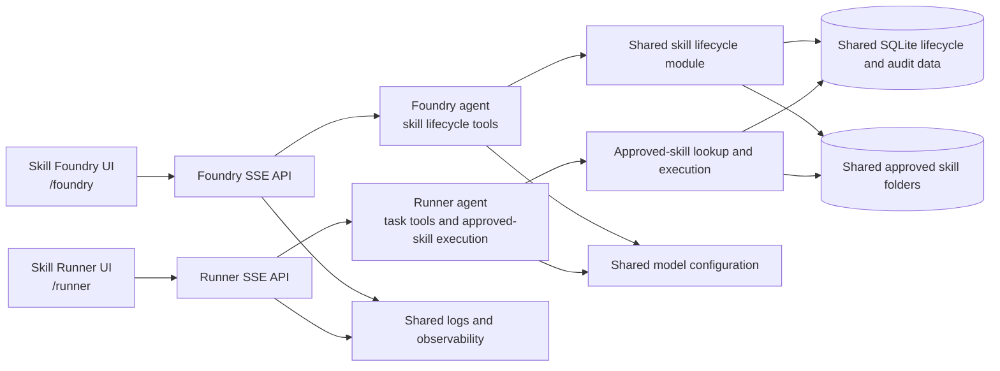

# Change Proposal: Separate Skill Foundry and Skill Runner Workspaces

**Status:** Approved and implemented in the current application.

## Summary

Split ASF’s current mixed chat into two distinct workspaces in the same project:

1. **Skill Foundry** manages reusable skills: discover existing capabilities when relevant to skill management, draft, test, revise, approve, version, and deprecate them.
2. **Skill Runner** handles user tasks. It uses real task tools and searches for and executes approved ASF skills when a request is a plausible match.

The workspaces have separate pages, chat endpoints, agent instructions, tool sets, and volatile conversations. They share the existing approved skill folders, lifecycle database, provider/model configuration, logs, and sandbox. This keeps skill creation and skill execution separate without creating a second project or a second skills library.

## Motivation

The current single agent has competing responsibilities. Its instructions encourage approved-skill discovery even for greetings, producing unnecessary tool calls and noisy activity. At the same time, task requests can be answered directly by the language model even when deterministic execution would be more reliable. The same agent also owns skill proposals and execution, making it difficult to define when it should act as a task assistant versus a capability manager.

The proposed split gives each agent a narrow purpose and makes the UI’s intent clear before a request is sent.

## Alignment with the submitted project brief

The submitted brief defines ASF as a capability-management framework and requires conversational use of tools and approved skills, plus a reviewable skill lifecycle. This proposal preserves those elements:

- Skill creation remains explicit, inspectable, testable, and human-approved.
- Approved skill execution remains available as part of the product, through Skill Runner.
- Skill files remain Deep Agents-compatible `SKILL.md` directories, with the existing lifecycle and audit data.
- Generated Python continues to run only in the isolated sandbox.
- Chat transcripts and unsaved drafts remain volatile; approved skills and lifecycle evidence remain persistent.

The change refines the brief’s single conversational agent into two role-specific conversations. The task-execution capability is retained rather than removed; it is placed in its own workspace.

## Proposed user experience

### Skill Foundry

- Entry page: `/foundry`.
- Chat endpoint: `POST /api/foundry/chat/stream`.
- Primary actions: create a reusable skill, inspect the library, test and revise a draft, approve a passing skill, edit a version, or deprecate a skill.
- A greeting or general question receives a brief response without searching the skill library.
- Ordinary task execution is outside this workspace. If the user asks for a one-off calculation or research task, the UI can direct them to Skill Runner.
- The Foundry agent may read approved-skill metadata when the user is managing skills or when it needs to avoid proposing a duplicate. It does not execute approved skills to fulfill ordinary user tasks.

### Skill Runner

- Entry page: `/runner`.
- Chat endpoint: `POST /api/runner/chat/stream`.
- Primary actions: answer task requests using available real tools and relevant approved skills.
- Greetings and unrelated questions do not trigger skill discovery.
- The Runner searches for a skill only when the request plausibly matches a skill’s purpose, metadata, or inputs. If a matching approved Python/hybrid skill exists, it calls the execution tool with the user’s actual input and reports the tool result.
- It does not create, edit, approve, or deprecate skills. When a reusable capability is missing, it can direct the user to Skill Foundry without starting a draft itself.
- Arithmetic should use a matching approved calculator skill when one is available. ASF does not include a hard-coded calculator tool; users can create and approve a reusable calculator skill in Foundry.

Both pages have their own clear-conversation action and in-memory message list. Neither workspace persists chat transcripts. Navigation between pages does not merge their histories.

## Proposed architecture

Keep one FastAPI application and one local server process by default, with separate UI and SSE routes. This satisfies the separate workspace/entry-point requirement while keeping SQLite and process-local state predictable. The route layout can later be hosted on separate ports if a deployment requirement emerges; separate server processes are not part of this proposal.

Keep application code function-based, consistent with the submitted brief. Provide role-specific functions for Foundry and Runner agent creation and streaming, while sharing model construction, logging, approved skill storage, and sandbox helpers. Avoid a generic multi-agent framework or a second persistence layer.

### Route outline

| Route | Responsibility |
|---|---|
| `GET /foundry` | Render skill-authoring workspace. |
| `GET /runner` | Render task-execution workspace. |
| `POST /api/foundry/chat/stream` | Stream Foundry lifecycle activity, draft events, and response text. |
| `POST /api/runner/chat/stream` | Stream Runner task/tool/skill activity and response text. |
| `POST /api/foundry/chat/clear` | Clear Foundry’s volatile transcript. |
| `POST /api/runner/chat/clear` | Clear Runner’s volatile transcript. |
| Existing `/api/skills/...` routes | Shared library, draft review, test, approval, version, and deprecation operations. |

## Agent boundaries

| Capability | Skill Foundry | Skill Runner |
|---|---:|---:|
| Respond briefly to greetings | Yes | Yes |
| Search approved skills for task execution | No | Yes, only for a plausible match |
| Execute an approved skill for a user task | No | Yes |
| Propose or revise a skill draft | Yes | No |
| Run sandbox tests for a draft | Yes, by explicit user action | No |
| Approve, version, or deprecate skills | Yes, under existing review rules | No |
| Use task tools such as web search | Only when needed for skill authoring/evaluation | Yes, subject to availability and truthful tool-result reporting |

Tool registration must enforce these boundaries, not rely on prompt wording alone. The Runner should not receive draft approval or lifecycle mutation tools. The Foundry should not receive the approved-skill execution tool as a general task tool.

## Test and evaluation plan

The change should add or revise tests before considering the implementation complete:

1. **Routing and UI:** each page points to its own SSE and clear routes; profile/model settings remain shared.
2. **Conversation isolation:** Foundry messages and clear actions do not alter Runner history, and vice versa; neither transcript is persisted.
3. **Tool boundaries:** inspect each agent’s registered tools and assert the Foundry cannot run approved skills for tasks and Runner cannot create, approve, or deprecate skills.
4. **Greeting behavior:** “Hi” returns a short answer without `list_approved_skills`, web search, or skill proposal tools in either workspace.
5. **Runner skill selection:** a request matching an approved JSON validator calls the approved-skill execution tool with the supplied JSON; an unrelated request does not search the skill catalog.
6. **Runner tool behavior:** use an approved calculator skill when available and report its actual output. Web search is called only for a search/current-information request and cites returned results.
7. **Foundry lifecycle:** an explicit reusable-skill request can produce a draft, run tests, revise, and require explicit approval; one-off tasks do not silently create drafts.
8. **SSE and errors:** each stream emits role-appropriate progress and final events; provider/tool failures are visible and not replaced with fabricated success.
9. **Live agent checks:** opt-in tests send bounded real requests to each configured role and assert expected tool calls and returned tool results. Keep these separate from deterministic offline tests and document possible provider charges.

Example behavior checks:

| Input | Workspace | Expected behavior |
|---|---|---|
| `Hi` | Foundry or Runner | Brief greeting, no tool call. |
| `Calculate 432134234234 + 2352435235` | Runner | Calculator tool returns `434486669469`; no skill search/proposal. |
| `Validate this JSON: ...` with approved validator | Runner | Find and execute the existing validator with supplied input. |
| `Create a Python calculator skill for add, subtract, multiply, and divide` | Foundry | Prepare a reviewable candidate with inputs, implementation, and tests; do not approve automatically. |
| `Make a calculator skill` | Runner | Explain that reusable skill creation belongs in Foundry; do not generate or save a draft. |

## Documentation plan

Keep project documentation under `doc/`. `doc/technical_readme.md` is the canonical technical architecture document; update it alongside any approved implementation changes. Keep proposals, decisions, and test/evaluation documentation in the same folder. The root README should link to the canonical technical document and describe how to open both workspaces.

## Scope and non-goals

Included: two user-facing workspaces, role-specific agent setup and prompts, separate route-level conversations and clear actions, shared approved skill store and lifecycle, shared model configuration, role-specific tools, UI navigation, and tests for routing, agent behavior, isolation, and tool use.

Not included: separate projects, separate skill directories or databases, persistent chat history, automatic skill approval, unrestricted autonomous skill creation by Runner, a new vector database, a new frontend framework, multiple server processes by default, or claiming that an agent is correct based only on natural-language output.

## Decision requested

Approve or revise this separation before implementation. In particular, confirm that `/foundry` and `/runner` are suitable workspace entry URLs and that one server process with separate page/API routes meets the intended meaning of separate startup endpoints.
