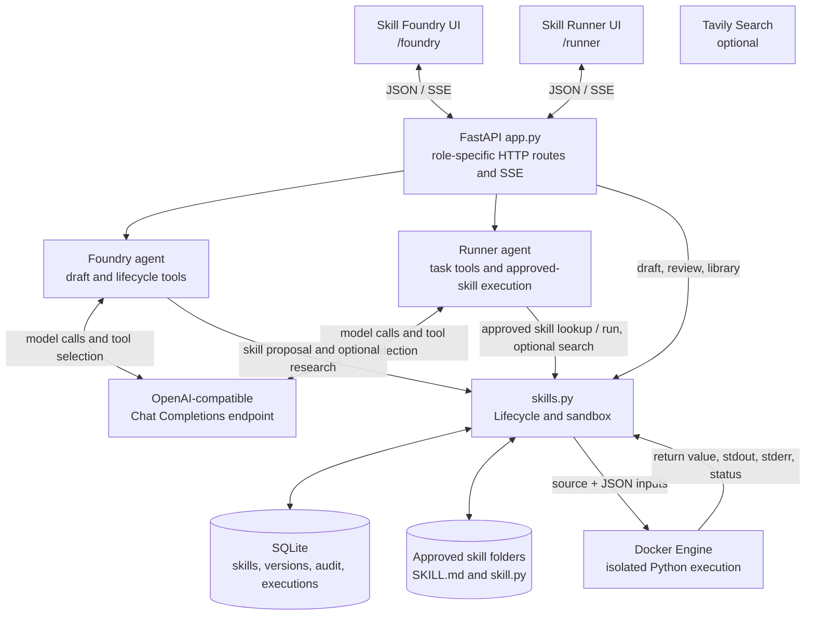

# Agent Skill Foundry — Technical Architecture

This document describes the implementation in this repository. It is intended for engineers reviewing the architecture, extending the application, or assessing its current operational and security boundaries. It reflects the current local-first prototype; it does not describe capabilities that are only planned.

## 1. System overview

Agent Skill Foundry (ASF) is a single-process local web application with two role-specific workspaces. Skill Foundry creates, tests, reviews, versions, and deprecates reusable skills. Skill Runner handles ordinary user tasks and uses relevant approved skills and task tools. Each workspace has its own page, API routes, agent instructions/tool set, and volatile conversation history. They share provider configuration, approved skill storage, SQLite lifecycle records, observability, and sandbox.

The system has four main parts:

1. A browser UI served by FastAPI, using static HTML, CSS, and JavaScript.
2. A role-aware agent adapter that configures LangChain `ChatOpenAI` and Deep Agents, exposing narrowly scoped lifecycle tools to Foundry and task/approved-skill tools to Runner.
3. A skill lifecycle module backed by SQLite and approved-skill files on disk.
4. A Docker-based runner for Python skill source. Draft code is not run in the web server process.



### Runtime topology

- One Uvicorn process binds to `127.0.0.1` by default; `PORT` changes the port.
- Foundry and Runner conversation state are separate Python process globals. Foundry tracks one active skill per conversation: one clarification round is allowed, then the draft occupies the right-hand review workspace. Starting another skill is blocked until Clear conversation removes the unapproved draft and resets session state. Approved skills remain in the library. State is local to the process and is not coordinated between multiple workers.
- SQLite and skill files are local persistent state under the repository by default.
- The browser makes same-origin requests to the FastAPI server. There is no separate frontend build or API gateway.
- Provider requests leave the machine and go to the configured endpoint. Tavily requests leave the machine when search is enabled. Skill source is mounted into the local Docker container.

This topology is designed for a single local user. It currently has no authentication, authorization, tenant isolation, distributed state, or multi-worker coordination.

## 2. Repository map

| Path | Responsibility |
|---|---|
| `run.py` | Changes the working directory to the project root, checks core imports, loads `.env`, and starts Uvicorn. |
| `app.py` | FastAPI app, provider configuration, workspace pages and role-specific chat SSE/clear routes, skill and draft routes, process-local conversation histories. |
| `agent.py` | Shared model setup plus Foundry/Runner-specific prompts and tools, approved-skill execution adapter, model event translation. |
| `skills.py` | SQLite setup and queries, draft creation, promotion/versioning, audit history, approved skill filesystem, Docker execution. |
| `templates/index.html` | Skill Foundry UI shell and dialogs. |
| `templates/runner.html` | Independent Skill Runner UI shell. |
| `static/app.js` | Foundry API client, message rendering, SSE reader, activity display, skill library and review interactions. |
| `static/runner.js` | Runner API client, message rendering, SSE reader, and task activity display. |
| `static/styles.css` | UI presentation and responsive styles. |
| `skills/approved/<slug>/SKILL.md` | Agent Skills-compatible instructions plus purpose, input, output, and executable contracts. |
| `skills/approved/<slug>/skill.py` | Optional Python implementation stored for approved Python/hybrid skills. |
| `data/skills.sqlite` | Persistent skill records, versions, audit entries, and execution records. |
| `tests/` | Pytest coverage for agent helpers, route behavior, lifecycle, and sandbox outcomes. |
| `.env.example` | Non-secret starter configuration. Copy to `.env`; keep `.env` out of version control. |

## 3. Technology and dependencies

- **Python 3.12+** application runtime.
- **FastAPI**, **Starlette**, and **Uvicorn** for HTTP, static assets, templates, and streaming responses.
- **Pydantic** for request payload validation.
- **Jinja2** for rendering the page shell.
- **Deep Agents** for graph-based agent execution and skill-loading integration.
- **LangChain ChatOpenAI** for OpenAI-compatible chat endpoints.
- **LangChain Tavily** for optional live web search.
- **SQLite** via Python's standard library for persistence.
- **PyYAML** for Agent Skills frontmatter serialization.
- **Docker Engine** for optional isolated execution of Python skills.
- **pytest** and **httpx** are in the development dependency set; requirements installation includes them.

`requirements.in` is the manually maintained dependency input, while `requirements.txt` is the pip install file. `pyproject.toml` declares application dependencies and the `dev` dependency group.

## 4. Startup and configuration

### Startup sequence

1. `run.py` sets the current directory and Python import path to the project root.
2. It checks for core web dependencies and prints the install command if dependencies are missing.
3. It loads `.env` and launches `app:app` with Uvicorn, loopback host, and the configured `PORT` or `8000`.
4. Importing `app.py` loads `.env` again and initializes FastAPI, static assets, Jinja templates, and separate empty `FOUNDRY_MESSAGES` and `RUNNER_MESSAGES` lists.
5. SQLite tables are created lazily when `skills.connect()` is called.

### Environment variables

| Variable | Purpose | Default / behavior |
|---|---|---|
| `OPENAI_BASE_URL` | Base URL for an OpenAI-compatible endpoint. | Example: `https://api.openai.com/v1`. Set by the Settings form. |
| `OPENAI_API_KEY` | Provider API key. | Preferred by the app and written by the Settings form. |
| `OPENAI_COMPAT_BASE_URL` | Compatibility alias for base URL. | Read if `OPENAI_BASE_URL` is absent. |
| `OPENAI_COMPAT_API_KEY` | Compatibility alias for API key. | Read if `OPENAI_API_KEY` is absent. |
| `LLM_MODEL` | Provider model identifier. | `gpt-4o-mini`. |
| `GROQ_API_KEY` | Legacy provider key fallback. | If used without an explicit base URL/key, code selects Groq's OpenAI-compatible URL. |
| `ASF_LLM_PROVIDER` | Active provider profile. | `openai_compatible` by default; choose `azure_openai` for Azure demos. |
| `AZURE_OPENAI_API_KEY` | Azure resource key. | Kept separate from `OPENAI_API_KEY`; never returned by configuration API. |
| `AZURE_OPENAI_ENDPOINT` | Azure resource endpoint. | Defaults to the endpoint supplied in `.env.example`. |
| `AZURE_OPENAI_API_VERSION` | Azure data-plane API version. | Defaults to `2024-08-01-preview`; `v1` uses the Azure OpenAI v1 route. |
| `AZURE_OPENAI_DEPLOYMENT_NAME` | Azure model deployment name. | Defaults to `gpt-5.3-chat`; set this to the deployment name in the Azure resource. |
| `AZURE_OPENAI_REASONING_EFFORT` | Optional GPT reasoning effort. | Empty leaves the model default; provider/model support varies. |
| `ASF_MODELS` | Optional JSON array defining the complete model picker list. | Each entry has a unique `id`, `provider_type`, `model`, `base_url` (or Azure `endpoint`), and `api_key_env`; optional `label`, Azure `api_version`, and `reasoning_effort`. If set, legacy profiles are not appended. |
| `ASF_ACTIVE_MODEL` | Selected profile ID. | Updated by the chat model picker; defaults to the legacy provider choice when unset or unknown. |
| `TAVILY_API_KEY` | Enables the web search tool. | Optional; without it, chat can still run. |
| `PORT` | Local HTTP port. | `8000`. |
| `LOG_LEVEL` | Minimum ASF log level. | `INFO`; use `DEBUG` for more event metadata. |
| `ASF_LOG_FILE` | Persistent log destination. | `data/logs/asf.log`; empty disables file logging but keeps console logs. |

The Settings endpoint accepts a provider type, endpoint, API key, and model/deployment name. It requires an `http://` or `https://` URL, non-empty model, and key (the active provider's existing key may be reused if the submitted key is blank). OpenAI-compatible settings write `OPENAI_BASE_URL`, `OPENAI_API_KEY`, and `LLM_MODEL`; Azure settings write the separate `AZURE_OPENAI_*` variables. Selecting one profile does not overwrite the other profile's credentials. Both are saved in the project `.env` and take effect in the running process immediately. The endpoint does not make a test request to verify that credentials, endpoint, API version, and deployment work together.

OpenAI-compatible providers use `ChatOpenAI`; Azure dated API versions use `AzureChatOpenAI`. Setting Azure API version to `v1` uses `ChatOpenAI` with `{AZURE_OPENAI_ENDPOINT}/openai/v1` and the deployment name as its model identifier. GPT-5 Azure requests use `max_completion_tokens` and omit `temperature`; general calls use `LLM_MAX_TOKENS` and Foundry uses `ASF_SKILL_DRAFT_MAX_TOKENS` (default 2400) to leave enough output space for complete code skill proposals. A dated API version that predates this parameter may be rejected by the endpoint, so select an API version supported by the deployment or `v1`. Model/API compatibility, tool calling, context size, and structured output behavior are provider-dependent.

`llm_provider.model_profiles()` uses validated entries from `ASF_MODELS` as the complete picker list (JSON, up to 100 profiles and 32 KiB). If it is unset or invalid, the two legacy environment profiles are used. IDs are unique and limited to alphanumeric characters plus `.`, `_`, and `-`; provider types are `openai_compatible` and `azure_openai`; endpoints must use HTTP or HTTPS. `api_key_env` names the environment variable containing the key. The config endpoint exposes IDs, labels, provider types, endpoint/model metadata, the key-variable name, and configured status, never key values. `PUT /api/config/model` rejects unknown or unconfigured profiles, then saves the selected ID to `.env` and process environment. The browser picker is disabled during a chat request and selects the profile used by the next chat and skill revision call. Updating catalog JSON requires an app restart; changing the active profile does not.

The connection-settings dialog lists all profiles and adds or edits custom catalog entries through `POST` or `PUT /api/config/model-profile`. New profiles of either provider type append to `ASF_MODELS` and become available immediately. Each entry requires a unique ID; catalogs are limited to 100 entries and 32 KiB. The editor selects the saved profile and stores a newly entered key only in the environment variable named by `api_key_env`. Leaving the key field blank preserves the existing key. The dialog exposes the API key variable name for clarity, never its value. Built-in profiles continue to use `PUT /api/config/provider` and the established OpenAI/Azure variables.

### Logging and request correlation

ASF uses Python's standard logging package through `observability.py`. It writes to stdout and, by default, to `data/logs/asf.log`. Each file rotates at 20 MiB and retains five backups (`asf.log.1` through `asf.log.5`). The default log directory is Git-ignored. The `/logs` page (also linked from the chat header) lists the active and rotated files, sorted newest first, selects the newest by default, and displays up to 10,000 newest lines from the selected file. Its **Download HTML snapshot** action exports the loaded log lines and full-file AI summary to a standalone HTML file that includes a notice that the data was generated from local logs and may be incomplete or rotated; it is diagnostic output, not authoritative audit evidence. The dashboard reads only the configured log path and numbered backups managed by the rotating handler.

A pure ASGI middleware creates a fresh UUID request ID for each HTTP request, stores it in a context variable, logs request start and completion with method, path, status, and duration, and returns the ID in the `X-Request-ID` response header. Because the middleware wraps the full ASGI response call, the ID stays available while SSE response bodies are generated. Query strings and request bodies are excluded from access logs.

Application events include provider configuration changes (model and endpoint host only), agent start/end status and duration, model-call status/duration and reported token counts, tool start/end status and duration, sandbox outcomes, draft lifecycle events, and audit actions. For debugging, the full Foundry system prompt, model inputs and outputs, user prompt/history, tool inputs/outputs, and detailed exceptions are logged. This may include credentials or other sensitive text supplied in a prompt or generated skill; keep `data/logs` private and redact logs before sharing. Draft diagnostics also log validation errors, the stored draft ID, and the app's lookup/SSE delivery status. The dashboard aggregates HTTP request count/failures/average duration plus agent runs, model calls, per-tool run/failure counts, prompt/completion/total tokens, and calls without token usage across the full selected file; the table's row limit does not truncate these metrics. `ChatOpenAI(stream_usage=True)` requests usage for streaming responses; providers may omit it, so missing usage is marked unavailable and never estimated. Token cost is not calculated because prices vary by provider/model and are not supplied by the log event.

Use `LOG_LEVEL=DEBUG` for more detailed metadata, or `ASF_LOG_FILE=` to disable persistent logging while retaining console output. When investigating an issue, copy the `X-Request-ID` value from the browser's Network response headers and search for that ID in the log file or use the dashboard search field.

## 5. Request and agent flows

### Chat request and streaming

1. Foundry sends `POST /api/foundry/chat/stream`; Runner sends `POST /api/runner/chat/stream`, each with `{ "message": "..." }`. Legacy `/api/chat/stream` aliases Runner.
2. The route trims and validates the message, appends the user turn to the matching workspace history, and bounds that list to its latest 20 message objects.
3. The route returns a `text/event-stream` response. A background asyncio task runs `agent.stream_agent` while the response generator forwards queued events as SSE `data:` frames. A comment keepalive frame is emitted during periods with no event.
4. `stream_agent` creates the matching role-specific agent for the request and supplies a small, trimmed recent history. Only Runner receives approved skill Markdown files.
5. Deep Agents emits lifecycle events. The adapter forwards model text chunks, translates tool start/end into user-facing labels, and tracks the events for the final result.
6. On successful proposal creation, the tool returns the stored draft ID. `stream_agent` extracts that ID; the app retrieves that exact ID from `skills.DRAFTS`, emits it as a draft payload, runs one critique, appends the assistant reply to Foundry history, and emits `done`. Runner emits its reply and activity to Runner's history only.
7. The browser reads the response stream, renders tokens as they arrive, and retains activity events in an expandable panel attached to that assistant message. Foundry uses a two-pane layout: transcript and composer on the left, persistent draft editor, first-pass critique, tests, and revisions on the right. Narrow viewports stack the panes.

The client implements a small Markdown renderer for headings, paragraphs, lists, fenced code, tables, emphasis, inline code, and links. Text and HTML-sensitive content are escaped before insertion. This is a purpose-built subset, not a full CommonMark implementation.

#### SSE event contract

Frames are JSON objects following `data: <JSON>\n\n`. The current event types include:

| Type | Fields / meaning |
|---|---|
| `token` | `text`: incremental assistant response text. |
| `progress` | `message`: high-level model activity such as thinking. |
| `tool_start` | `name`, `label`, and optional tool `input`. |
| `tool_end` | `name`, `label`, and clipped tool `output`. |
| `draft_progress` | `fields`: proposal fields that have arrived as complete JSON values while the model streams its proposal tool call; partial or malformed field fragments are withheld. |
| `error` | `message`: setup or runtime failure. |
| `draft` | `draft`: newly prepared skill proposal for the review UI. |
| `critique_start` | `draft_id`: the draft is visible; one automated test/critique pass is starting. |
| `critique` | `draft_id`, test result, and a concise model critique based only on that result. |
| `skill_offer` | `request`: repeatable task text offered for proposal creation. |
| `done` | `reply` and optional `error`: end-of-request event. |

Keepalives are SSE comment frames (`: keepalive`) and are not JSON events. Complete proposal fields can appear in the right-hand workspace as `draft_progress` events while the model is still generating tool arguments. The server then emits `draft`, `critique_start`, `critique`, and `done`, so the editable review card appears before the one-shot sandbox test and critique complete.

An explicit skill creation request suppresses intermediate generated text. When a draft is created, the chat reply is the short prompt “Review the draft below and let me know what you’d like changed.” The proposal and one-shot test/critique are displayed in the draft card instead of duplicating the proposal in chat. Skill activity remains attached to the chat message until the user clears the conversation in the UI.

Foundry session state allows one clarification exchange: if the agent asks a question before preparing a draft, the next user turn is marked as its answer and the agent is instructed to proceed with reasonable assumptions rather than ask again. Once a draft is created, another skill request receives a clear-session message; this remains true after review removes the draft from the in-memory draft map. Clear conversation removes any still-unapproved draft and resets the active skill and clarification state. It does not remove a skill already accepted into the library.

### Agent configuration and policy

`agent.create_agent()` returns a configuration error if no provider key is present. Otherwise it:

1. Instantiates `ChatOpenAI` with model, API key, temperature zero, and a bounded `max_tokens` setting.
2. Applies the configured compatible endpoint URL (or the legacy Groq fallback).
3. Instantiates Tavily only when `TAVILY_API_KEY` is present.
4. Registers workspace-specific tools. Foundry can list approved skill metadata and prepare a draft; Runner can list and execute approved skills. Either role gets web search only when configured.
5. Supplies approved skill directories and file contents to Runner only. Foundry does not receive skill execution tools or the approved-skill filesystem.

Foundry's system prompt focuses on reusable skill management, direct greetings, and proposal creation for explicit reusable-skill requests; it does not handle ordinary task execution. The proposal tool's model-facing schema keeps `proposal` as a JSON object, then validates its contents inside the tool with the stricter Pydantic `SkillProposal` model. Optional descriptive metadata (`expected_output`, `tools`, and `scope_note`) has safe defaults; tool metadata accepts JSON values because it is descriptive and is not executed. This avoids rejecting an otherwise usable draft over omitted or differently shaped optional metadata. No serialized JSON text is requested. Python source errors receive one focused structured repair using compiler and contract diagnostics, without regenerating the rest of the proposal. Python/hybrid proposals are checked for syntax, a synchronous returning `run(inputs)` entry point, nonempty input contracts, and tests whose input objects match declared names and JSON types; the expected value is described as the actual JSON return shape, not prose or a schema. Tool input errors and repeated invalid proposals are surfaced in the activity stream; retrying is bounded so a malformed proposal cannot silently loop until graph recursion failure. When the model deliberately narrows a broad request, its scope note appears in the review card; there is no keyword-count complexity gate. Python skills run on Docker's default network and can make outbound HTTP/API calls when the host and Docker daemon permit them. Third-party dependencies remain uninstalled; proposals are directed to standard-library implementations unless the sandbox image is extended. If a proposal remains invalid, the agent explains the issue and asks the user to narrow scope rather than claim a draft was created. Python/hybrid source may call helpers and must return JSON-serializable output; generic names and `main()`/print-only code are explicitly excluded. Runner's prompt handles tasks, asks it to greet without tools, search approved skills only for plausible matches, and ground claims of execution in returned tool results. Both prompts describe tool results and skill instructions as untrusted data. Tool registration enforces the main lifecycle boundaries independently of prompt wording.

Foundry and Runner each keep a volatile in-memory history, bounded to 20 message objects per workspace. `_compact_history` passes up to four recent messages to the agent and truncates individual content strings beyond 1,600 characters. The current request is separately limited to 6,000 characters before it is passed to the agent. `/api/foundry/chat/clear` and `/api/runner/chat/clear` clear only their own histories. The legacy `/api/chat/clear` alias clears Runner.

### Workspace routes

| Route | Behavior |
|---|---|
| `GET /` and `GET /foundry` | Render Skill Foundry (`templates/index.html`). |
| `GET /runner` | Render Skill Runner (`templates/runner.html`). |
| `POST /api/foundry/chat/stream` | Stream Foundry agent activity and response. |
| `POST /api/runner/chat/stream` | Stream Runner agent activity and response. |
| `POST /api/foundry/chat/clear` | Clear Foundry conversation only. |
| `POST /api/runner/chat/clear` | Clear Runner conversation only. |

Model picker/settings, library APIs, logs, SQLite and approved skill directories remain shared. Foundry's tool set is skill listing/proposal and optional web search for research; it does not get the approved-skill execution tool or skill directories. Runner gets approved-skill lookup/execution and optional web search; it does not get skill proposal/review/approval tools. Both prompts explicitly direct greetings to short direct responses without tools. There are no built-in task-specific calculator tools; arithmetic support can be supplied by a user-reviewed, approved calculator skill.

### Approved skill selection and execution

The agent receives approved `SKILL.md` files through a virtual `/skills/approved/` directory. `skills.approved_skill_files()` walks the approved directory but includes a Markdown file only when its corresponding SQLite record exists and has `approved` status. Python source is not added to the agent's virtual filesystem; executable source is fetched from the approved skill record only after the model calls `run_approved_skill`.

`execute_approved_skill(slug, inputs)` checks that the record exists, is approved, and has type `python` or `hybrid`. It then delegates to `skills.test_code()` and packages the result for the tool response. Instruction-only skills are supplied as instructions and are not passed to the Python runner.

Matching for duplicate-suggestion suppression is intentionally simple: lowercased words in the request are compared with the approved skill name and metadata tags. Any shared term currently suppresses a new offer; this is not semantic retrieval and can produce both false positives and false negatives.

## 6. Skill lifecycle and persistence

### Draft structure

Drafts are stored in the in-memory `skills.DRAFTS` dictionary and have an ID, original request, candidate skill object, and a list of test attempts. A candidate can include:

- `name`, `description`, and `skill_type` (`instruction`, `python`, or `hybrid` in current flows).
- `instructions` and optional complete Python `code`.
- `inputs`, `expected_output`, dependencies, permissions, tags, category, tests, and tools.

Direct draft API calls have defaults and carry the original task as a sample input. The Foundry proposal tool accepts the full candidate authored by the agent; a focused JSON validation proposal helper remains available for JSON-specific requests. Missing or generic names are replaced with a human-readable name derived from the request. Drafts disappear when the process restarts; test execution results for draft attempts are retained only in that draft object until then.

`skills.skill_doc()` writes the approved `SKILL.md` frontmatter and body. The body contains the purpose, candidate agent instructions, JSON input contract, and expected output. Python/hybrid skills also get the executable contract requiring `run(inputs: dict)` to return the result. Runner receives these documents as agent skills and gets input/output/instruction metadata from the skill-list tool; Python source remains private to the approved record until `run_approved_skill` executes it.

### Review and promotion gates

1. The user may edit candidate fields and test data.
2. Testing a Python/hybrid draft calls the Docker runner and appends the result and the source snapshot to `attempts`.
3. Accepting a Python/hybrid draft requires a successful latest test whose recorded source text matches the current code. Changing code after testing makes that attempt stale.
4. Instruction-only skills do not require Python execution.
5. Promotion writes a spec-style `SKILL.md`, optional `skill.py`, and a SQLite row. It increments the existing version if the same slug is already present, adds a version-history row, and writes an approval audit record.
6. Updating an approved Python/hybrid skill tests the changed code before promotion using the submitted inputs, or the first declared test inputs when none are supplied. A passing update reuses that validation result during promotion so the code is not executed twice for one save. Deprecation changes its status and records an audit event; deprecated skills are omitted from agent loading.

Skill slugs are generated from the human-readable name using lowercase alphanumeric words separated by single hyphens, truncated to 60 characters. The Markdown frontmatter name uses the slug, consistent with the Agent Skills identifier requirement; the library preserves the display name.

### SQLite schema

Tables are created in `skills.connect()` using `CREATE TABLE IF NOT EXISTS`:

| Table | Role | Notable fields |
|---|---|---|
| `skills` | Current record, one row per slug. | Name, description, type, status, version, JSON content/metadata, created/updated timestamps, latest test JSON, latest execution status. |
| `versions` | Immutable snapshots at approval/update time. | Slug, version, serialized content/metadata, timestamp, actor, note. |
| `audit` | Governance and lifecycle actions. | Optional slug, action, JSON detail, timestamp. |
| `executions` | Python runner outcomes. | Optional slug, source hash, success, output, error, duration, timestamp. |

`skills.get_skill()` joins the current row with ordered version history and up to 30 recent audit entries through separate queries. `list_skills()` loads records then filters in Python by status and case-insensitive substring across name, description, and tags. There are no foreign-key constraints or explicit migration/version framework at present.

### Filesystem and database consistency

Promotion writes the approved Markdown/code files before persisting SQLite records. These writes are not part of a single transaction across SQLite and the filesystem. A process or filesystem failure in between can leave an orphaned or stale file; approved file exposure still checks the SQLite status before loading Markdown, but there is no automated reconciliation job.

## 7. Python skill sandbox

### Execution protocol

`skills.test_code(code, inputs, slug)`:

1. Rejects empty source. If Docker is not installed, reports `sandbox_unavailable` without executing code on the host.
2. Creates a temporary directory under `data/sandbox`, writes `skill.py` and `inputs.json`, and passes a small runner program to the container.
3. Invokes `docker run` with the `python:3.12-alpine` image and Docker's default network, plus a read-only root filesystem, non-root UID, memory/CPU/process limits, dropped Linux capabilities, no-new-privileges, a restricted `/tmp`, and a read-only bind mount of the temporary work directory.
4. Runs Python isolated mode (`-I`). The host checks syntax and requires a synchronous `run(inputs)` entry point. The container imports the skill file with `runpy`, loads JSON input, invokes `run(inputs)`, requires a non-`None` JSON-serializable return value, and captures user stdout and stderr separately from the runner envelope. `main()` and print-only code are rejected as skill entry points.
5. Enforces a 15-second host-side subprocess timeout and clips captured output to `MAX_OUTPUT` (20,000 characters).
6. Parses the runner JSON envelope, distinguishes the user's return value/prints from Docker/runner errors, hashes the source, and records the execution in SQLite when Docker invocation was attempted.

The container uses Docker's default network, which permits outbound requests if Docker Desktop, host firewall rules, and network policy allow them. Python skills can therefore contact external APIs; they must still validate user-supplied URLs and avoid exposing credentials in outputs. Docker must already be installed and its daemon available. The base image must be present locally or Docker must be able to obtain it; image acquisition is managed by Docker outside the isolated container. The sandbox is a useful isolation boundary for this local prototype, but it has not undergone a formal security review and should not be treated as a hardened multi-tenant code execution service.

## 8. HTTP API surface

Payload models are declared in `app.py`. FastAPI/Pydantic performs JSON parsing and basic type validation; business-level checks are described below.

| Method and path | Purpose |
|---|---|
| `GET /` | Render the single-page app shell. |
| `GET /foundry` | Render Skill Foundry; same page as `/`. |
| `GET /runner` | Render the separate Skill Runner page. |
| `GET /api/config` | Return provider/search configured flags, endpoint/model display values, and Docker availability. Does not reveal keys. |
| `PUT /api/config/provider` | Validate and persist endpoint URL, API key, and model. |
| `PUT /api/config/model-profile` | Update an existing custom `ASF_MODELS` entry and optionally its separately stored API key. |
| `POST /api/config/model-profile` | Add a custom OpenAI-compatible or Azure profile to `ASF_MODELS`. |
| `POST /api/foundry/chat/stream` | Accept `{message}` and stream Foundry activity and response over SSE. |
| `POST /api/runner/chat/stream` | Accept `{message}` and stream Runner activity and response over SSE. |
| `POST /api/foundry/chat/clear` | Clear only Foundry's process-local conversation. |
| `POST /api/runner/chat/clear` | Clear only Runner's process-local conversation. |
| `POST /api/chat/stream`, `/api/chat/clear` | Backward-compatible aliases for Runner. |
| `GET /api/skills?q=&status=` | List/filter skill records. |
| `GET /api/skills/{slug}` | Return skill record, content, history, and audit entries. |
| `PATCH /api/skills/{slug}` | Update content and create a new version after Python test passes when executable. |
| `POST /api/skills/{slug}/agent-revision` | Generate an unsaved structured proposal from user feedback and the current/proposed content; skill name/slug identity is preserved. |
| `POST /api/skills/{slug}/test` | Test executable source or return instruction-only ready status. |
| `POST /api/skills/{slug}/deprecate` | Mark skill deprecated. |
| `POST /api/skills/drafts` | Prepare a skill draft from `{message}`. |
| `GET /api/skills/drafts/{draft_id}` | Fetch an in-memory draft. |
| `PUT /api/skills/drafts/{draft_id}` | Update draft skill fields. |
| `POST /api/skills/drafts/{draft_id}/test` | Test the current draft candidate and record attempt. |
| `POST /api/skills/drafts/{draft_id}/critique` | Run one automatic first test and concise model critique for a visible draft. |
| `POST /api/skills/drafts/{draft_id}/review` | Accept or reject; acceptance enforces test rules. Feedback returns `needs_revision`. |
| `POST /api/skills/drafts/{draft_id}/revise` | Ask the configured model for structured changes using feedback; clears prior test attempts. |
| `/docs` | FastAPI-generated interactive API documentation. |

There is no API authentication or CSRF/session model. By default the server binds to loopback, but deployment beyond a trusted local machine requires additional controls.

### Agent-assisted revision contract

The skill detail UI sends `POST /api/skills/{slug}/agent-revision` with `{ "feedback": "...", "current_skill": null }`. For follow-up edits, `current_skill` contains the last proposed version. The route uses the existing structured revision schema, returns `{ "status": "revision_proposed", "skill": ..., "diff": ... }`, and always discards its temporary in-memory revision draft. The saved approved record is unchanged until the user applies the proposal.

Applying a proposal uses `PATCH /api/skills/{slug}` with `{ "content": ..., "inputs": ... }`. The optional `inputs` object is used to validate executable revisions; if omitted, the first declared test case is used. Validation failure or sandbox unavailability returns without promotion. A passing result creates the next version while preserving the existing skill name/slug. Instruction-only revisions do not require Python execution.

## 9. Frontend behavior

`static/app.js` and `static/runner.js` are dependency-free clients for their respective workspaces. Both:

- Sends JSON requests through a helper that converts non-2xx responses to UI errors.
- Reads the SSE response body with `ReadableStream.getReader()` and a `TextDecoder`; it splits frames on blank lines and parses `data:` frames as JSON.
- Appends streamed response text using the local Markdown formatter.
- Shows a small animated, accessible work-status bot while a response is being prepared; its short status text changes as progress and tool events arrive, then disappears when the answer completes (or remains with an error state on failure).
- Displays model/tool activity in a collapsed-by-default expandable `<details>` panel on the relevant assistant response. Tool inputs and clipped outputs are rendered as escaped text, and verbose skill proposal payloads are summarized in the activity view.
- Keep the selected model profile in sync through the shared configuration API and clear only their own server-side volatile transcript.

Foundry additionally displays draft cards with editable fields, test input, test history, feedback/revision controls, reject, and accept actions, and provides the persistent skill library with search/status filters, details, test, manual edit, agent edit, and deprecate actions. **Edit with agent** opens a focused chat in the skill detail view. Follow-up prompts revise the previous proposal; the UI shows changed fields as before/after diffs. Nothing is saved until the user applies the proposal. Python/hybrid revisions are validated with the displayed JSON inputs before the next version is written; a failed/unavailable validation leaves the approved version unchanged. Runner has no lifecycle editor; it focuses on task chat, tool activity, and approved skill use.

The browser does not persist conversations in local storage, cookies, or SQLite. It retains current DOM state only until refresh/clear; drafts live server-side in memory until restart or disposition.

## 10. Testing and verification

Run the suite from the repository root:

```powershell
python -m pip install -r requirements.txt
python -m pytest -q
```

Current coverage is organized as follows:

- `tests/test_agent.py`: history compaction, task/skill intent detection, derived skill names, complete JSON proposal transfer, callable JSON skill source, approved-skill execution delegation, progress labels, and OpenAI-compatible/Azure dated/v1 model setup.
- `tests/test_app_routes.py`: OpenAI-compatible and Azure profile validation/persistence, separate credential preservation, home/config state, chat request validation/SSE response contract/history clearing, skill route errors, draft edit/test/review flows and acceptance gates, plus agent revision proposal without persistence and preserved skill identity.
- `tests/test_skill_lifecycle.py`: proposal defaults, SQLite promotion, files/frontmatter, search, version history, failed/pass promotion, update validation with selected inputs, deprecation, audit details.
- `tests/test_skill_execution.py`: return values and captured prints, rejection of `main()`/print-only/`None`-returning code, empty/no-Docker/daemon-unavailable states, runtime exceptions, timeout, malformed runner envelope, restrictive Docker arguments, approved Markdown exposure, slug/frontmatter naming.
- `tests/test_observability.py`: file logging format, request ID correlation, response header injection, lifecycle event coverage, and query-string exclusion.
- `tests/test_log_dashboard.py`: newest-first log selection, generated-data warning and controls, reverse chronological parsing, full-file AI and per-tool metrics with truncated display rows, and rejection of unlisted paths.
- `tests/conftest.py`: temporary project/database isolation and a direct endpoint-function adapter.
- `tests/integration/test_live_chat.py`: opt-in real provider checks for a Foundry greeting without tools and a Runner request that calls `list_approved_skills`, receives its result, and returns a response.

The default suite mocks provider and Docker subprocess boundaries; it requires neither credentials nor a live Docker daemon and uses temporary SQLite storage for lifecycle and execution-record checks. Its route tests call endpoint functions directly to avoid a Windows socket-based test client. The opt-in live suite makes a real provider request through ASF's production agent and requires provider credentials and network access; it may incur usage charges. Enable it with `$env:ASF_LIVE_TESTS = "1"` in PowerShell or `set ASF_LIVE_TESTS=1` in `cmd.exe`, then run `python -m pytest -m live -q`. The live test checks model-to-tool calling but does not run the HTTP SSE route. Latest offline verification: **78 tests passed, 2 opt-in live tests skipped** (`python -m pytest -q --basetemp=data/pytest-tmp`).

## 11. Security, privacy, and operational boundaries

- **Local credentials:** `.env` contains secrets and is ignored by Git. Provider keys are not returned by `/api/config`. The Settings form writes key material in plain text to `.env`; filesystem protections are therefore important.
- **Network egress:** Model calls, optional Tavily searches, and Python skills can contact external services. Python containers use Docker's default network; outbound access depends on local Docker and host network policy.
- **Local-only by default:** Uvicorn binds to `127.0.0.1`. Do not expose the application on a shared network without authentication, TLS, request protections, rate limits, and an explicit threat review.
- **Process state:** Chat messages and drafts are global and volatile. Multiple users or Uvicorn workers would have isolated but unsynchronized state.
- **Skill trust:** Only reviewed/approved skill Markdown is loaded. Skill instructions and tool results remain untrusted input to the model. Python source runs only through Docker.
- **Audit scope:** Lifecycle changes and sandbox executions that reach Docker are recorded; provider prompts/responses and chat transcripts are not persisted to SQLite.
- **Retention:** SQLite records and approved skill files persist until manually removed. There is no retention or deletion policy interface yet.
- **Error boundaries:** Provider/model setup and invocation errors are surfaced to the chat stream. A provider can still reject unsupported model features or return incompatible payloads.

## 12. Known limitations and likely evolution points

The current implementation intentionally favors a small, inspectable local application over a production service. Architectural follow-up areas include:

1. Replace process-global conversation/draft state with explicit conversation IDs and a durable or intentionally scoped store if multi-session support is required.
2. Introduce authentication, authorization, CSRF protections, rate limiting, and secure secret storage before network exposure.
3. Add schema migrations and transactional/reconciliation behavior spanning SQLite metadata and skill files.
4. Add semantic or hybrid retrieval with measured relevance if lexical matching becomes insufficient.
5. Define a provider capability contract and validate endpoint/model connectivity, tool calling, and structured output in Settings.
6. Test actual async SSE delivery and browser rendering in CI, including disconnects, cancellation, provider errors, concurrent requests, and large outputs.
7. Formalize skill input/output schemas, test assertions, dependency packaging, sandbox image lifecycle, resource policies, and adversarial sandbox review.
8. Add observability suitable for local troubleshooting while redacting prompts, credentials, and sensitive tool data.

## 13. Architecture decision summary

| Decision | Current choice | Trade-off |
|---|---|---|
| Web delivery | FastAPI serves both API and static UI. | Simple local setup; less separation for independent frontend deployment. |
| Agent/provider | Deep Agents plus LangChain `ChatOpenAI`. | Broad OpenAI-compatible endpoint support; compatibility depends on provider feature parity. |
| Search | Optional Tavily tool. | Current web research when configured; external key and network dependency. |
| Skill storage | SQLite records plus Agent Skills Markdown/code folders. | Human-readable instructions and queryable history; filesystem/DB consistency must be managed. |
| Chat/draft persistence | Process memory. | No transcript retention and easy local operation; restart loss and no session isolation. |
| Python execution | Docker container with default network, constrained mounts/resources. | Enables API integrations while keeping source off the host process; outbound access is host-dependent and the sandbox is not fully hardened. |
| Retrieval | Metadata and substring matching. | Transparent and dependency-light; weaker recall/precision than semantic retrieval. |

