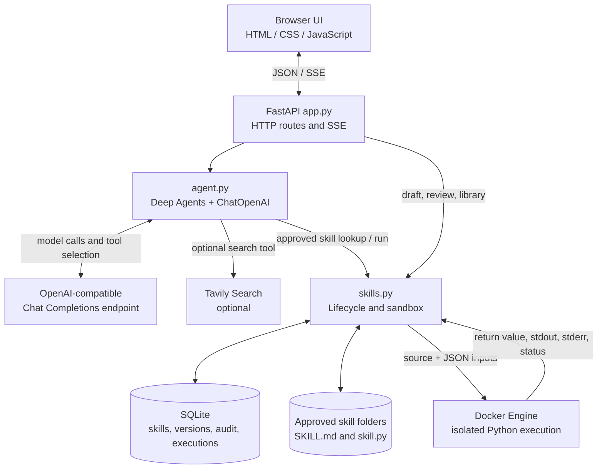

# Agent Skill Foundry — Technical Architecture

This document describes the implementation in this repository. It is intended for engineers reviewing the architecture, extending the application, or assessing its current operational and security boundaries. It reflects the current local-first prototype; it does not describe capabilities that are only planned.

## 1. System overview

Agent Skill Foundry (ASF) is a single-process local web application for conversational use of approved reusable skills and for authoring, testing, reviewing, versioning, and deprecating those skills.

The system has four main parts:

1. A browser UI served by FastAPI, using static HTML, CSS, and JavaScript.
2. An agent adapter that configures a LangChain `ChatOpenAI` client and a Deep Agents graph, then exposes approved skills, draft creation, and optional web search as tools.
3. A skill lifecycle module backed by SQLite and approved-skill files on disk.
4. A Docker-based runner for Python skill source. Draft code is not run in the web server process.



### Runtime topology

- One Uvicorn process binds to `127.0.0.1` by default; `PORT` changes the port.
- Conversation state and skill drafts are Python process globals. They are not session-scoped or shared between workers.
- SQLite and skill files are local persistent state under the repository by default.
- The browser makes same-origin requests to the FastAPI server. There is no separate frontend build or API gateway.
- Provider requests leave the machine and go to the configured endpoint. Tavily requests leave the machine when search is enabled. Skill source is mounted into the local Docker container.

This topology is designed for a single local user. It currently has no authentication, authorization, tenant isolation, distributed state, or multi-worker coordination.

## 2. Repository map

| Path | Responsibility |
|---|---|
| `run.py` | Changes the working directory to the project root, checks core imports, loads `.env`, and starts Uvicorn. |
| `app.py` | FastAPI app, provider configuration, chat SSE endpoint, skill and draft routes, process-local conversation state. |
| `agent.py` | Model setup, Deep Agents tools, prompt policy, approved-skill execution adapter, model event translation. |
| `skills.py` | SQLite setup and queries, draft creation, promotion/versioning, audit history, approved skill filesystem, Docker execution. |
| `templates/index.html` | Single-page UI shell and dialogs. |
| `static/app.js` | Browser API client, message rendering, SSE reader, activity display, skill library and review interactions. |
| `static/styles.css` | UI presentation and responsive styles. |
| `skills/approved/<slug>/SKILL.md` | Agent Skills-compatible natural-language instructions for approved skills. |
| `skills/approved/<slug>/skill.py` | Optional Python implementation stored for approved Python/hybrid skills. |
| `data/skills.sqlite` | Persistent skill records, versions, audit entries, and execution records. |
| `tests/` | Pytest coverage for agent helpers, route behavior, lifecycle, and sandbox outcomes. |
| `.env.example` | Non-secret starter configuration. Copy to `.env`; keep `.env` out of version control. |

## 3. Technology and dependencies

- **Python 3.12+** application runtime.
- **FastAPI**, **Starlette**, and **Uvicorn** for HTTP, static assets, templates, and streaming responses.
- **Pydantic** for request payload validation.
- **Jinja2** for rendering the page shell.
- **Deep Agents** for graph-based agent execution and skill-loading integration.
- **LangChain ChatOpenAI** for OpenAI-compatible chat endpoints.
- **LangChain Tavily** for optional live web search.
- **SQLite** via Python's standard library for persistence.
- **PyYAML** for Agent Skills frontmatter serialization.
- **Docker Engine** for optional isolated execution of Python skills.
- **pytest** and **httpx** are in the development dependency set; requirements installation includes them.

`requirements.in` is the manually maintained dependency input, while `requirements.txt` is the pip install file. `pyproject.toml` declares application dependencies and the `dev` dependency group.

## 4. Startup and configuration

### Startup sequence

1. `run.py` sets the current directory and Python import path to the project root.
2. It checks for core web dependencies and prints the install command if dependencies are missing.
3. It loads `.env` and launches `app:app` with Uvicorn, loopback host, and the configured `PORT` or `8000`.
4. Importing `app.py` loads `.env` again and initializes the FastAPI app, static mount, Jinja template loader, and empty in-memory `MESSAGES` list.
5. SQLite tables are created lazily when `skills.connect()` is called.

### Environment variables

| Variable | Purpose | Default / behavior |
|---|---|---|
| `OPENAI_BASE_URL` | Base URL for an OpenAI-compatible endpoint. | Example: `https://api.openai.com/v1`. Set by the Settings form. |
| `OPENAI_API_KEY` | Provider API key. | Preferred by the app and written by the Settings form. |
| `OPENAI_COMPAT_BASE_URL` | Compatibility alias for base URL. | Read if `OPENAI_BASE_URL` is absent. |
| `OPENAI_COMPAT_API_KEY` | Compatibility alias for API key. | Read if `OPENAI_API_KEY` is absent. |
| `LLM_MODEL` | Provider model identifier. | `gpt-4o-mini`. |
| `GROQ_API_KEY` | Legacy provider key fallback. | If used without an explicit base URL/key, code selects Groq's OpenAI-compatible URL. |
| `ASF_LLM_PROVIDER` | Active provider profile. | `openai_compatible` by default; choose `azure_openai` for Azure demos. |
| `AZURE_OPENAI_API_KEY` | Azure resource key. | Kept separate from `OPENAI_API_KEY`; never returned by configuration API. |
| `AZURE_OPENAI_ENDPOINT` | Azure resource endpoint. | Defaults to the endpoint supplied in `.env.example`. |
| `AZURE_OPENAI_API_VERSION` | Azure data-plane API version. | Defaults to `2024-08-01-preview`; `v1` uses the Azure OpenAI v1 route. |
| `AZURE_OPENAI_DEPLOYMENT_NAME` | Azure model deployment name. | Defaults to `gpt-5.3-chat`; set this to the deployment name in the Azure resource. |
| `AZURE_OPENAI_REASONING_EFFORT` | Optional GPT reasoning effort. | Empty leaves the model default; provider/model support varies. |
| `ASF_MODELS` | Optional JSON array defining the complete model picker list. | Each entry has a unique `id`, `provider_type`, `model`, `base_url` (or Azure `endpoint`), and `api_key_env`; optional `label`, Azure `api_version`, and `reasoning_effort`. If set, legacy profiles are not appended. |
| `ASF_ACTIVE_MODEL` | Selected profile ID. | Updated by the chat model picker; defaults to the legacy provider choice when unset or unknown. |
| `TAVILY_API_KEY` | Enables the web search tool. | Optional; without it, chat can still run. |
| `PORT` | Local HTTP port. | `8000`. |
| `LOG_LEVEL` | Minimum ASF log level. | `INFO`; use `DEBUG` for more event metadata. |
| `ASF_LOG_FILE` | Persistent log destination. | `data/logs/asf.log`; empty disables file logging but keeps console logs. |

The Settings endpoint accepts a provider type, endpoint, API key, and model/deployment name. It requires an `http://` or `https://` URL, non-empty model, and key (the active provider's existing key may be reused if the submitted key is blank). OpenAI-compatible settings write `OPENAI_BASE_URL`, `OPENAI_API_KEY`, and `LLM_MODEL`; Azure settings write the separate `AZURE_OPENAI_*` variables. Selecting one profile does not overwrite the other profile's credentials. Both are saved in the project `.env` and take effect in the running process immediately. The endpoint does not make a test request to verify that credentials, endpoint, API version, and deployment work together.

OpenAI-compatible providers use `ChatOpenAI`; Azure dated API versions use `AzureChatOpenAI`. Setting Azure API version to `v1` uses `ChatOpenAI` with `{AZURE_OPENAI_ENDPOINT}/openai/v1` and the deployment name as its model identifier. GPT-5 Azure requests use `max_completion_tokens` and omit `temperature`; the token ceiling uses `LLM_MAX_TOKENS`. A dated API version that predates this parameter may be rejected by the endpoint, so select an API version supported by the deployment or `v1`. Model/API compatibility, tool calling, context size, and structured output behavior are provider-dependent.

`llm_provider.model_profiles()` uses validated entries from `ASF_MODELS` as the complete picker list (JSON, up to 100 profiles and 32 KiB). If it is unset or invalid, the two legacy environment profiles are used. IDs are unique and limited to alphanumeric characters plus `.`, `_`, and `-`; provider types are `openai_compatible` and `azure_openai`; endpoints must use HTTP or HTTPS. `api_key_env` names the environment variable containing the key. The config endpoint exposes IDs, labels, provider types, endpoint/model metadata, the key-variable name, and configured status, never key values. `PUT /api/config/model` rejects unknown or unconfigured profiles, then saves the selected ID to `.env` and process environment. The browser picker is disabled during a chat request and selects the profile used by the next chat and skill revision call. Updating catalog JSON requires an app restart; changing the active profile does not.

The connection-settings dialog lists all profiles and adds or edits custom catalog entries through `POST` or `PUT /api/config/model-profile`. New profiles of either provider type append to `ASF_MODELS` and become available immediately. Each entry requires a unique ID; catalogs are limited to 100 entries and 32 KiB. The editor selects the saved profile and stores a newly entered key only in the environment variable named by `api_key_env`. Leaving the key field blank preserves the existing key. The dialog exposes the API key variable name for clarity, never its value. Built-in profiles continue to use `PUT /api/config/provider` and the established OpenAI/Azure variables.

### Logging and request correlation

ASF uses Python's standard logging package through `observability.py`. It writes to stdout and, by default, to `data/logs/asf.log`. Each file rotates at 20 MiB and retains five backups (`asf.log.1` through `asf.log.5`). The default log directory is Git-ignored. The `/logs` page (also linked from the chat header) lists the active and rotated files, sorted newest first, selects the newest by default, and displays up to 10,000 newest lines from the selected file. Its **Download HTML snapshot** action exports the loaded log lines and full-file AI summary to a standalone HTML file that includes a notice that the data was generated from local logs and may be incomplete or rotated; it is diagnostic output, not authoritative audit evidence. The dashboard reads only the configured log path and numbered backups managed by the rotating handler.

A pure ASGI middleware creates a fresh UUID request ID for each HTTP request, stores it in a context variable, logs request start and completion with method, path, status, and duration, and returns the ID in the `X-Request-ID` response header. Because the middleware wraps the full ASGI response call, the ID stays available while SSE response bodies are generated. Query strings and request bodies are excluded from access logs.

Application events include provider configuration changes (model and endpoint host only), agent start/end status and duration, each model-call status/duration and provider-reported prompt/completion/total tokens, tool start/end status and duration, sandbox availability and outcomes, source hash and duration for Python tests, draft review states, skill approvals/version numbers, deprecation, and audit actions. The dashboard aggregates HTTP request count/failures/average duration plus agent runs, model calls, per-tool run/failure counts, prompt/completion/total tokens, and calls without token usage across the full selected file; the table's row limit does not truncate these metrics. `ChatOpenAI(stream_usage=True)` requests usage for streaming responses; providers may omit it, so missing usage is marked unavailable and never estimated. Token cost is not calculated because prices vary by provider/model and are not supplied by the log event. API keys, prompts, user inputs, skill source, and raw tool outputs are not logged. Error paths log exception classes rather than exception messages to reduce the chance of logging provider or user data. The HTTP response may still contain a detailed error for the caller.

Use `LOG_LEVEL=DEBUG` for more detailed metadata, or `ASF_LOG_FILE=` to disable persistent logging while retaining console output. When investigating an issue, copy the `X-Request-ID` value from the browser's Network response headers and search for that ID in the log file or use the dashboard search field.

## 5. Request and agent flows

### Chat request and streaming

1. The browser sends `POST /api/chat/stream` with `{ "message": "..." }`.
2. The route trims and validates the message, appends the user turn to `MESSAGES`, and bounds the list to its latest 20 message objects.
3. The route returns a `text/event-stream` response. A background asyncio task runs `agent.stream_agent` while the response generator forwards queued events as SSE `data:` frames. A comment keepalive frame is emitted during periods with no event.
4. `stream_agent` creates a fresh agent for the request and supplies a small, trimmed recent history plus approved skill Markdown files.
5. Deep Agents emits lifecycle events. The adapter forwards model text chunks, translates tool start/end into user-facing labels, and tracks the events for the final result.
6. When the graph finishes, the route may emit a draft payload or a skill suggestion, appends the assistant reply to `MESSAGES`, and emits a final `done` event.
7. The browser reads the response stream, renders tokens as they arrive, and retains activity events in an expandable panel attached to that assistant message.

The client implements a small Markdown renderer for headings, paragraphs, lists, fenced code, tables, emphasis, inline code, and links. Text and HTML-sensitive content are escaped before insertion. This is a purpose-built subset, not a full CommonMark implementation.

#### SSE event contract

Frames are JSON objects following `data: <JSON>\n\n`. The current event types include:

| Type | Fields / meaning |
|---|---|
| `token` | `text`: incremental assistant response text. |
| `progress` | `message`: high-level model activity such as thinking. |
| `tool_start` | `name`, `label`, and optional tool `input`. |
| `tool_end` | `name`, `label`, and clipped tool `output`. |
| `error` | `message`: setup or runtime failure. |
| `draft` | `draft`: newly prepared skill proposal for the review UI. |
| `skill_offer` | `request`: repeatable task text offered for proposal creation. |
| `done` | `reply` and optional `error`: end-of-request event. |

Keepalives are SSE comment frames (`: keepalive`) and are not JSON events. The order is event-driven; a response may contain progress/tool events, text chunks, then a draft/offer and `done`.

An explicit skill creation request suppresses intermediate generated text and returns the concise message “Draft ready for review below.” after the proposal tool has run. The proposal itself is sent separately to the review card. Skill activity remains attached to the chat message until the user clears the conversation in the UI.

### Agent configuration and policy

`agent.create_agent()` returns a configuration error if no provider key is present. Otherwise it:

1. Instantiates `ChatOpenAI` with model, API key, temperature zero, and a bounded `max_tokens` setting.
2. Applies the configured compatible endpoint URL (or the legacy Groq fallback).
3. Instantiates Tavily only when `TAVILY_API_KEY` is present.
4. Registers tools for listing approved skills, running an approved executable skill, and proposing one draft. It adds web search only when configured.
5. Supplies the approved skill directory to Deep Agents when approved skill files are available.

The system prompt asks the model to check approved skills first, execute a matching Python/hybrid skill with the user's actual input, base claims of execution on tool results, avoid duplicate skill suggestions, use web search for current facts, and keep explicit skill creation replies concise. Tool results and skill instructions are treated as untrusted data.

Conversation history is volatile and globally shared in process. `_compact_history` passes up to four recent messages to the agent and truncates individual content strings beyond 1,600 characters. The current request is separately limited to 6,000 characters before it is passed to the agent.

### Approved skill selection and execution

The agent receives approved `SKILL.md` files through a virtual `/skills/approved/` directory. `skills.approved_skill_files()` walks the approved directory but includes a Markdown file only when its corresponding SQLite record exists and has `approved` status. Python source is not added to the agent's virtual filesystem; executable source is fetched from the approved skill record only after the model calls `run_approved_skill`.

`execute_approved_skill(slug, inputs)` checks that the record exists, is approved, and has type `python` or `hybrid`. It then delegates to `skills.test_code()` and packages the result for the tool response. Instruction-only skills are supplied as instructions and are not passed to the Python runner.

Matching for duplicate-suggestion suppression is intentionally simple: lowercased words in the request are compared with the approved skill name and metadata tags. Any shared term currently suppresses a new offer; this is not semantic retrieval and can produce both false positives and false negatives.

## 6. Skill lifecycle and persistence

### Draft structure

Drafts are stored in the in-memory `skills.DRAFTS` dictionary and have an ID, original request, candidate skill object, and a list of test attempts. A candidate can include:

- `name`, `description`, and `skill_type` (`instruction`, `python`, or `hybrid` in current flows).
- `instructions` and optional complete Python `code`.
- `inputs`, `expected_output`, dependencies, permissions, tags, category, tests, and tools.

The generic proposal has defaults and carries the original task as a sample input. The agent has an additional deterministic JSON validation proposal helper. Drafts disappear when the process restarts; test execution results for draft attempts are retained only in that draft object until then.

### Review and promotion gates

1. The user may edit candidate fields and test data.
2. Testing a Python/hybrid draft calls the Docker runner and appends the result and the source snapshot to `attempts`.
3. Accepting a Python/hybrid draft requires a successful latest test whose recorded source text matches the current code. Changing code after testing makes that attempt stale.
4. Instruction-only skills do not require Python execution.
5. Promotion writes a spec-style `SKILL.md`, optional `skill.py`, and a SQLite row. It increments the existing version if the same slug is already present, adds a version-history row, and writes an approval audit record.
6. Updating an approved Python/hybrid skill tests the changed code before promotion. Deprecation changes its status and records an audit event; deprecated skills are omitted from agent loading.

Skill slugs are generated from the human-readable name using lowercase alphanumeric words separated by single hyphens, truncated to 60 characters. The Markdown frontmatter name uses the slug, consistent with the Agent Skills identifier requirement; the library preserves the display name.

### SQLite schema

Tables are created in `skills.connect()` using `CREATE TABLE IF NOT EXISTS`:

| Table | Role | Notable fields |
|---|---|---|
| `skills` | Current record, one row per slug. | Name, description, type, status, version, JSON content/metadata, created/updated timestamps, latest test JSON, latest execution status. |
| `versions` | Immutable snapshots at approval/update time. | Slug, version, serialized content/metadata, timestamp, actor, note. |
| `audit` | Governance and lifecycle actions. | Optional slug, action, JSON detail, timestamp. |
| `executions` | Python runner outcomes. | Optional slug, source hash, success, output, error, duration, timestamp. |

`skills.get_skill()` joins the current row with ordered version history and up to 30 recent audit entries through separate queries. `list_skills()` loads records then filters in Python by status and case-insensitive substring across name, description, and tags. There are no foreign-key constraints or explicit migration/version framework at present.

### Filesystem and database consistency

Promotion writes the approved Markdown/code files before persisting SQLite records. These writes are not part of a single transaction across SQLite and the filesystem. A process or filesystem failure in between can leave an orphaned or stale file; approved file exposure still checks the SQLite status before loading Markdown, but there is no automated reconciliation job.

## 7. Python skill sandbox

### Execution protocol

`skills.test_code(code, inputs, slug)`:

1. Rejects empty source. If Docker is not installed, reports `sandbox_unavailable` without executing code on the host.
2. Creates a temporary directory under `data/sandbox`, writes `skill.py` and `inputs.json`, and passes a small runner program to the container.
3. Invokes `docker run` with the `python:3.12-alpine` image, `--network none`, read-only root filesystem, non-root UID, memory/CPU/process limits, dropped Linux capabilities, no-new-privileges, a restricted `/tmp`, and a read-only bind mount of the temporary work directory.
4. Runs Python isolated mode (`-I`). The runner imports the skill file with `runpy`, loads JSON input, invokes `run(inputs)` (or a `result` fallback), and captures user stdout and stderr separately from the runner envelope.
5. Enforces a 15-second host-side subprocess timeout and clips captured output to `MAX_OUTPUT` (20,000 characters).
6. Parses the runner JSON envelope, distinguishes the user's return value/prints from Docker/runner errors, hashes the source, and records the execution in SQLite when Docker invocation was attempted.

The `--network none` setting applies to the container. Docker must already be installed and its daemon available. The base image must be present locally or Docker must be able to obtain it; image acquisition is managed by Docker outside the isolated container. The sandbox is a useful isolation boundary for this local prototype, but it has not undergone a formal security review and should not be treated as a hardened multi-tenant code execution service.

## 8. HTTP API surface

Payload models are declared in `app.py`. FastAPI/Pydantic performs JSON parsing and basic type validation; business-level checks are described below.

| Method and path | Purpose |
|---|---|
| `GET /` | Render the single-page app shell. |
| `GET /api/config` | Return provider/search configured flags, endpoint/model display values, and Docker availability. Does not reveal keys. |
| `PUT /api/config/provider` | Validate and persist endpoint URL, API key, and model. |
| `PUT /api/config/model-profile` | Update an existing custom `ASF_MODELS` entry and optionally its separately stored API key. |
| `POST /api/config/model-profile` | Add a custom OpenAI-compatible or Azure profile to `ASF_MODELS`. |
| `POST /api/chat/stream` | Accept `{message}` and return SSE. Empty trimmed messages return 422. |
| `POST /api/chat/clear` | Clear process-local conversation messages. |
| `GET /api/skills?q=&status=` | List/filter skill records. |
| `GET /api/skills/{slug}` | Return skill record, content, history, and audit entries. |
| `PATCH /api/skills/{slug}` | Update content and create a new version after Python test passes when executable. |
| `POST /api/skills/{slug}/test` | Test executable source or return instruction-only ready status. |
| `POST /api/skills/{slug}/deprecate` | Mark skill deprecated. |
| `POST /api/skills/drafts` | Prepare a skill draft from `{message}`. |
| `GET /api/skills/drafts/{draft_id}` | Fetch an in-memory draft. |
| `PUT /api/skills/drafts/{draft_id}` | Update draft skill fields. |
| `POST /api/skills/drafts/{draft_id}/test` | Test the current draft candidate and record attempt. |
| `POST /api/skills/drafts/{draft_id}/review` | Accept or reject; acceptance enforces test rules. Feedback returns `needs_revision`. |
| `POST /api/skills/drafts/{draft_id}/revise` | Ask the configured model for structured changes using feedback; clears prior test attempts. |
| `/docs` | FastAPI-generated interactive API documentation. |

There is no API authentication or CSRF/session model. By default the server binds to loopback, but deployment beyond a trusted local machine requires additional controls.

## 9. Frontend behavior

`static/app.js` is a dependency-free browser client. It:

- Sends JSON requests through a helper that converts non-2xx responses to UI errors.
- Reads the SSE response body with `ReadableStream.getReader()` and a `TextDecoder`; it splits frames on blank lines and parses `data:` frames as JSON.
- Appends streamed response text using the local Markdown formatter.
- Displays model/tool activity in an expandable `<details>` panel on the relevant assistant response. Tool inputs and clipped outputs are rendered as escaped text.
- Displays draft cards with editable fields, test input, test history, feedback/revision controls, reject, and accept actions.
- Displays the persistent skill library with search/status filters, details, test, edit, and deprecate actions.
- Clears the server-side volatile transcript and chat/draft UI when the user selects Clear conversation.

The browser does not persist conversations in local storage, cookies, or SQLite. It retains current DOM state only until refresh/clear; drafts live server-side in memory until restart or disposition.

## 10. Testing and verification

Run the suite from the repository root:

```powershell
python -m pip install -r requirements.txt
python -m pytest -q
```

Current coverage is organized as follows:

- `tests/test_agent.py`: history compaction, task/skill intent detection, duplicate-offer matching, JSON proposal source, approved skill execution delegation, progress labels, and OpenAI-compatible/Azure dated/v1 model setup.
- `tests/test_app_routes.py`: OpenAI-compatible and Azure profile validation/persistence, separate credential preservation, home/config state, chat request validation/SSE response contract/history clearing, skill route errors, draft edit/test/review flows and acceptance gates.
- `tests/test_skill_lifecycle.py`: proposal defaults, SQLite promotion, files/frontmatter, search, version history, failed/pass promotion, update, deprecation, audit details.
- `tests/test_skill_execution.py`: successful runner parsing and captured prints, empty/no-Docker/daemon-unavailable states, runtime exceptions, timeout, malformed runner envelope, restrictive Docker arguments, approved Markdown exposure, slug/frontmatter naming.
- `tests/test_observability.py`: file logging format, request ID correlation, response header injection, lifecycle event coverage, and query-string exclusion.
- `tests/test_log_dashboard.py`: newest-first log selection, generated-data warning and controls, reverse chronological parsing, full-file AI and per-tool metrics with truncated display rows, and rejection of unlisted paths.
- `tests/conftest.py`: temporary project/database isolation and a direct endpoint-function adapter.
- `tests/integration/test_live_chat.py`: opt-in real provider request through ASF's configured agent; asserts that the model calls `list_approved_skills`, receives a tool result, and returns a response.

The default suite mocks provider and Docker subprocess boundaries; it requires neither credentials nor a live Docker daemon and uses temporary SQLite storage for lifecycle and execution-record checks. Its route tests call endpoint functions directly to avoid a Windows socket-based test client. The opt-in live suite makes a real provider request through ASF's production agent and requires provider credentials and network access; it may incur usage charges. Enable it with `$env:ASF_LIVE_TESTS = "1"` in PowerShell or `set ASF_LIVE_TESTS=1` in `cmd.exe`, then run `python -m pytest -m live -q`. The live test checks model-to-tool calling but does not run the HTTP SSE route. Latest verification: **55 offline tests passed, 1 skipped** (`python -m pytest -q --basetemp .pytest-tmp` in the restricted workspace); `pip check` reported no broken requirements.

## 11. Security, privacy, and operational boundaries

- **Local credentials:** `.env` contains secrets and is ignored by Git. Provider keys are not returned by `/api/config`. The Settings form writes key material in plain text to `.env`; filesystem protections are therefore important.
- **Network egress:** Model calls and optional Tavily searches contact external services. Python containers use `--network none`.
- **Local-only by default:** Uvicorn binds to `127.0.0.1`. Do not expose the application on a shared network without authentication, TLS, request protections, rate limits, and an explicit threat review.
- **Process state:** Chat messages and drafts are global and volatile. Multiple users or Uvicorn workers would have isolated but unsynchronized state.
- **Skill trust:** Only reviewed/approved skill Markdown is loaded. Skill instructions and tool results remain untrusted input to the model. Python source runs only through Docker.
- **Audit scope:** Lifecycle changes and sandbox executions that reach Docker are recorded; provider prompts/responses and chat transcripts are not persisted to SQLite.
- **Retention:** SQLite records and approved skill files persist until manually removed. There is no retention or deletion policy interface yet.
- **Error boundaries:** Provider/model setup and invocation errors are surfaced to the chat stream. A provider can still reject unsupported model features or return incompatible payloads.

## 12. Known limitations and likely evolution points

The current implementation intentionally favors a small, inspectable local application over a production service. Architectural follow-up areas include:

1. Replace process-global conversation/draft state with explicit conversation IDs and a durable or intentionally scoped store if multi-session support is required.
2. Introduce authentication, authorization, CSRF protections, rate limiting, and secure secret storage before network exposure.
3. Add schema migrations and transactional/reconciliation behavior spanning SQLite metadata and skill files.
4. Add semantic or hybrid retrieval with measured relevance if lexical matching becomes insufficient.
5. Define a provider capability contract and validate endpoint/model connectivity, tool calling, and structured output in Settings.
6. Test actual async SSE delivery and browser rendering in CI, including disconnects, cancellation, provider errors, concurrent requests, and large outputs.
7. Formalize skill input/output schemas, test assertions, dependency packaging, sandbox image lifecycle, resource policies, and adversarial sandbox review.
8. Add observability suitable for local troubleshooting while redacting prompts, credentials, and sensitive tool data.

## 13. Architecture decision summary

| Decision | Current choice | Trade-off |
|---|---|---|
| Web delivery | FastAPI serves both API and static UI. | Simple local setup; less separation for independent frontend deployment. |
| Agent/provider | Deep Agents plus LangChain `ChatOpenAI`. | Broad OpenAI-compatible endpoint support; compatibility depends on provider feature parity. |
| Search | Optional Tavily tool. | Current web research when configured; external key and network dependency. |
| Skill storage | SQLite records plus Agent Skills Markdown/code folders. | Human-readable instructions and queryable history; filesystem/DB consistency must be managed. |
| Chat/draft persistence | Process memory. | No transcript retention and easy local operation; restart loss and no session isolation. |
| Python execution | Docker container, no container network, constrained mounts/resources. | Avoids host-process execution; requires Docker and is not a fully hardened hosted sandbox. |
| Retrieval | Metadata and substring matching. | Transparent and dependency-light; weaker recall/precision than semantic retrieval. |

